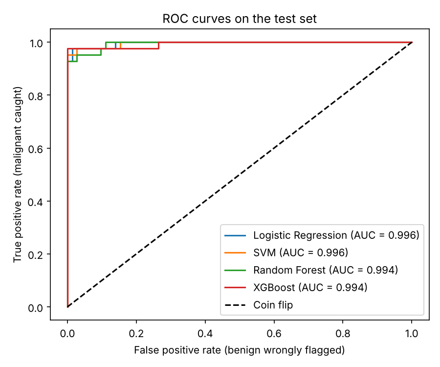
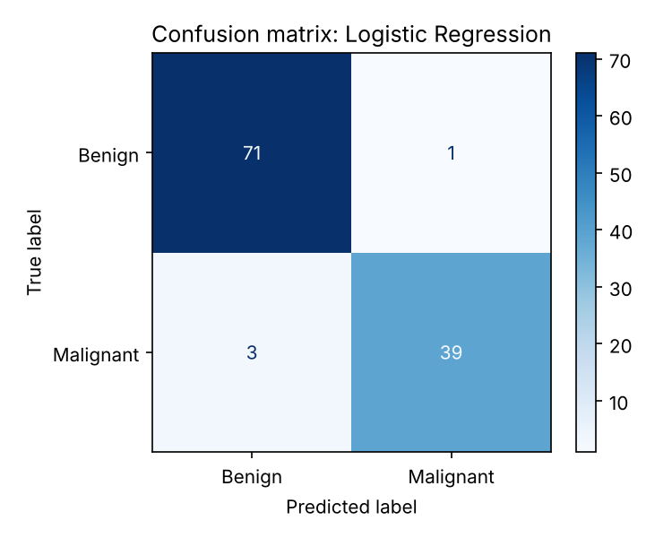
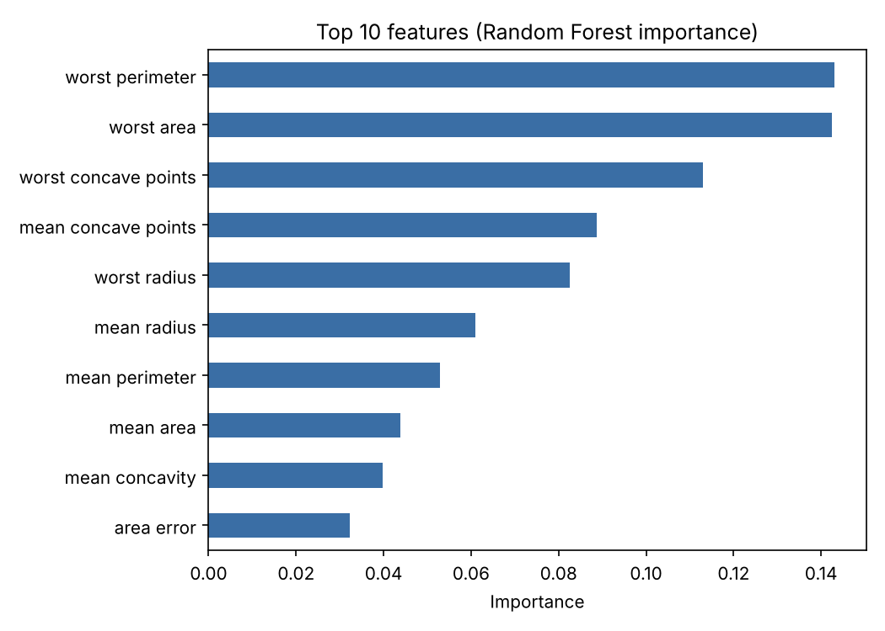

# Disease Prediction from Medical Data

Predicts whether a breast tumor is **malignant** (cancer) or **benign** from 30 lab measurements, comparing four machine learning models. Best model: **Logistic Regression, 96.5% test accuracy, 0.996 ROC-AUC**.

Built for the **CodeAlpha Machine Learning Internship, Task 4**.



<!-- After you post your LinkedIn video, paste its link here:
**Video walkthrough:** https://www.linkedin.com/... -->

## Dataset

**UCI Breast Cancer Wisconsin (Diagnostic)**, loaded with `sklearn.datasets.load_breast_cancer()`, so there is nothing to download.

- 569 patients, 30 numeric features, no missing values
- 212 malignant, 357 benign
- Each feature describes the cell nuclei in a microscope image of a tumor sample (radius, texture, perimeter, area, smoothness, concavity and more), as a mean, a standard error and a "worst" value.
- Source: [UCI Machine Learning Repository](https://archive.ics.uci.edu/dataset/17)

## Approach

1. **Explore:** check class balance and how features correlate.
2. **Split:** 80% training, 20% test, keeping the same malignant share in both (stratified).
3. **Models:** Logistic Regression, SVM, Random Forest and XGBoost. The first two scale the features first, inside a scikit-learn `Pipeline`.
4. **Cross-validation:** 5-fold CV on the training set only, scored by ROC-AUC.
5. **Tuning:** `GridSearchCV` for Logistic Regression (`C`) and SVM (`C`, `gamma`).
6. **Test:** every model scored once on the hidden 20%.
7. **Pick:** the model with the highest **recall** wins (ties broken by ROC-AUC), because missing a cancer is the costliest error.

## Results (test set, 114 patients)

| Model | Accuracy | Precision | Recall | F1 | ROC-AUC |
| --- | --- | --- | --- | --- | --- |
| Logistic Regression | 0.965 | 0.975 | 0.929 | 0.951 | 0.996 |
| SVM | 0.974 | 1.000 | 0.929 | 0.963 | 0.996 |
| Random Forest | 0.974 | 1.000 | 0.929 | 0.963 | 0.994 |
| XGBoost | 0.965 | 1.000 | 0.905 | 0.950 | 0.994 |

The best model caught 39 of 42 malignant tumors and flagged 1 benign tumor by mistake.

| Confusion matrix | Top 10 features |
| --- | --- |
|  |  |

The "worst" (largest) perimeter, area and concave points of the cell nuclei matter most, which fits the idea that cancer cells are larger and more irregular.

## How to run

**Option A: Google Colab (nothing to install)**

1. Go to [colab.research.google.com](https://colab.research.google.com), choose **File > Upload notebook**, and pick `notebooks/disease_prediction.ipynb`.
2. Press **Runtime > Run all**. Charts appear under each cell.

**Option B: your own computer**

```bash
# 1. Make a private Python environment for this project (optional but tidy)
python -m venv venv
source venv/bin/activate          # Windows: venv\Scripts\activate

# 2. Install the libraries
pip install -r requirements.txt

# 3. Train all four models (about 30 seconds); writes images/, results/, models/
python src/train.py

# 4. Use the saved model on a few patients
python src/predict.py
python src/predict.py 25 100      # patients number 25 and 100
```

## Project structure

```text
CodeAlpha_DiseasePrediction/
├── README.md
├── requirements.txt
├── notebooks/
│   └── disease_prediction.ipynb   # same steps as train.py, with outputs shown
├── src/
│   ├── train.py                   # loads data, trains + compares 4 models, saves charts
│   └── predict.py                 # loads the saved model and predicts patients
├── models/best_model.joblib       # the trained winner
├── results/results.csv            # scores of every model
└── images/                        # class balance, correlations, confusion matrix, ROC, features
```

## Key terms

- **Precision:** of the tumors flagged malignant, the share that really were.
- **Recall:** of the truly malignant tumors, the share the model caught.
- **F1:** a single score balancing precision and recall.
- **ROC-AUC:** how well the model ranks malignant above benign; 1.0 is perfect, 0.5 is a coin flip.
- **Cross-validation:** training and checking on 5 different slices of the training data for a steadier score.

## What I learned / next steps

- With medical data, **recall** matters more than accuracy: a missed cancer costs far more than a false alarm.
- Simple, scaled linear models can match tree ensembles on small, clean data.
- Next: lower the decision threshold to catch more malignant cases, and try the UCI heart disease and diabetes datasets.

*This is a learning project, not a medical tool.*
