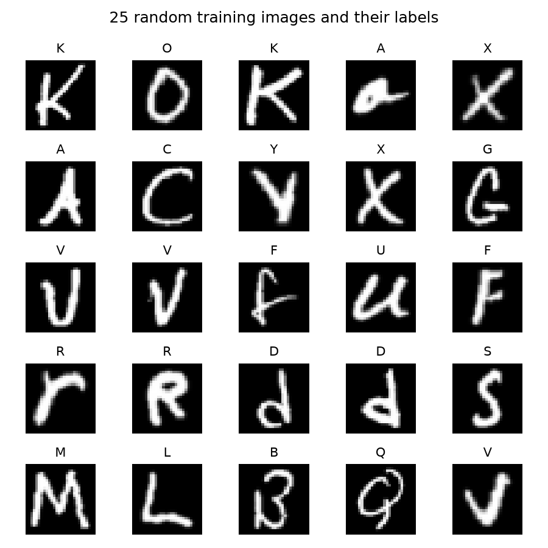
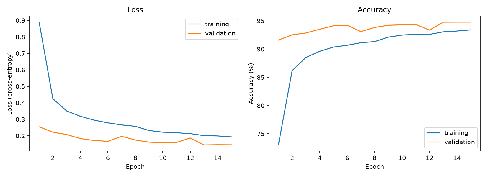
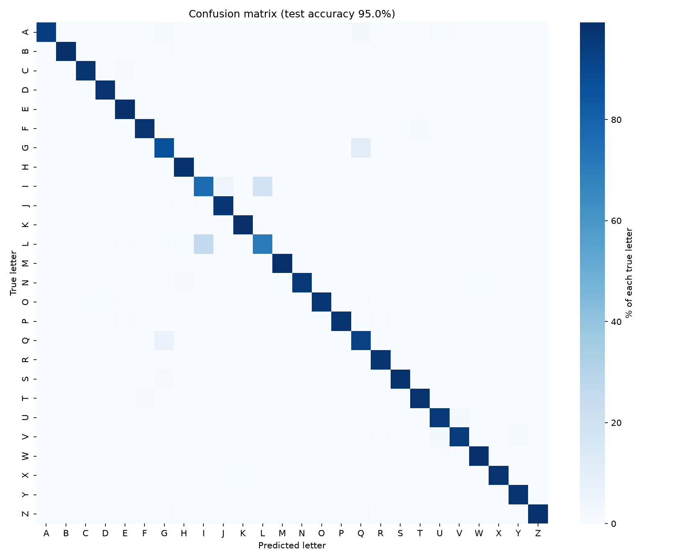

# Handwritten Character Recognition

A convolutional neural network (CNN) that reads handwritten letters **A to Z** from 28 x 28 pixel images, trained on **EMNIST Letters**. Test accuracy: **XX.X%** <!-- fill in from results/emnist_cnn_metrics.txt after training -->

Built for the **CodeAlpha Machine Learning Internship, Task 3**.



<!-- After you post your LinkedIn video, paste its link here:
**Video walkthrough:** https://www.linkedin.com/... -->

## Dataset

**EMNIST Letters** (Extended MNIST), loaded with TensorFlow Datasets (`emnist/letters`).

- 88,800 training images and 14,800 test images, 28 x 28 grayscale
- 26 balanced classes, upper and lower case of each letter merged
- Source: [NIST EMNIST page](https://www.nist.gov/itl/products-and-services/emnist-dataset) · [TensorFlow Datasets catalog](https://www.tensorflow.org/datasets/catalog/emnist)

Two fixes the code applies:
1. EMNIST images are stored mirrored and rotated, so each image is **transposed** to stand upright.
2. Labels run 1 to 26, so they are **shifted to 0 to 25**.

## Approach

1. **Load and clean:** transpose, scale pixels from 0-255 to 0-1, shift labels.
2. **Check:** plot 25 random images with their labels.
3. **Augment:** small random rotations, shifts and zooms while training (no flips, since a flipped letter can be a different letter).
4. **CNN:** two blocks of `Conv2D > BatchNorm > Conv2D > BatchNorm > MaxPool > Dropout` (32 then 64 filters), then `Dense(256) > Dropout(0.5) > Dense(26, softmax)`.
5. **Train:** Adam optimizer, up to 15 epochs, 10% validation split, early stopping and learning-rate reduction.
6. **Evaluate:** accuracy, per-letter precision/recall/F1, confusion matrix, and examples it got wrong.

## Results

<!-- Fill these in after running src/train.py -->

| Metric | Value |
| --- | --- |
| Test accuracy | XX.X% |
| Epochs run | XX |

| Training curves | Confusion matrix |
| --- | --- |
|  |  |

Most mistakes are letters that look alike in handwriting, such as **I / L** and **G / Q** (see `images/misclassified.png`).

## How to run

**Option A: Google Colab (recommended, free GPU)**

1. Go to [colab.research.google.com](https://colab.research.google.com), choose **File > Upload notebook**, and pick `notebooks/handwritten_character_recognition.ipynb`.
2. Turn on the GPU: **Runtime > Change runtime type > T4 GPU > Save**.
3. Press **Runtime > Run all**. The first run downloads EMNIST (about 536 MB) and training takes a few minutes.
4. Download the files it made (left sidebar, folder icon): `images/`, `results/`, `models/`. Put them in the same folders of this project.

**Option B: your own computer**

```bash
# 1. Make a private Python environment (optional but tidy)
python -m venv venv
source venv/bin/activate          # Windows: venv\Scripts\activate

# 2. Install the libraries
pip install -r requirements.txt

# 3. (Optional) 2-minute warm-up on MNIST digits to check everything works
python src/train.py --dataset digits --epochs 3

# 4. Train on EMNIST letters (downloads about 536 MB the first time)
python src/train.py

# 5. Read your own handwriting
python src/predict.py samples/*.png
```

**Testing your own handwriting:** write one letter with a thick dark marker on white paper, crop the photo so the letter fills it, and save it in `samples/`. `predict.py` turns it into a 28 x 28 white-on-black image like EMNIST and prints the top 3 guesses.

## Project structure

```text
CodeAlpha_HandwrittenCharacterRecognition/
├── README.md
├── requirements.txt
├── notebooks/
│   └── handwritten_character_recognition.ipynb   # same steps as train.py, Colab-ready
├── src/
│   ├── train.py        # load, clean, build CNN, train, evaluate, save
│   └── predict.py      # your photo -> top 3 letters
├── models/             # emnist_cnn.keras + emnist_cnn_classes.txt (after training)
├── results/            # emnist_cnn_metrics.txt (after training)
├── samples/            # photos of your own handwriting
└── images/             # sample grid, training curves, confusion matrix, mistakes
```

## Key terms

- **CNN:** a neural network that slides small filters over an image to find strokes and curves, then combines them into letters.
- **Epoch:** one full pass through the training images.
- **Data augmentation:** small random changes to training images so the model learns shapes, not exact pixel positions.
- **Dropout:** switching off random units while training so the network can't just memorize.
- **Softmax:** turns the 26 outputs into probabilities that add up to 1.

## What I learned / next steps

- Checking the data visually caught the EMNIST orientation problem before training.
- Augmentation and dropout keep validation accuracy close to training accuracy.
- Next: recognize whole words with a CRNN (CNN + recurrent layers), and add a drawing pad to test letters live.
